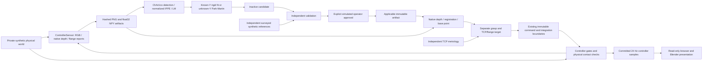
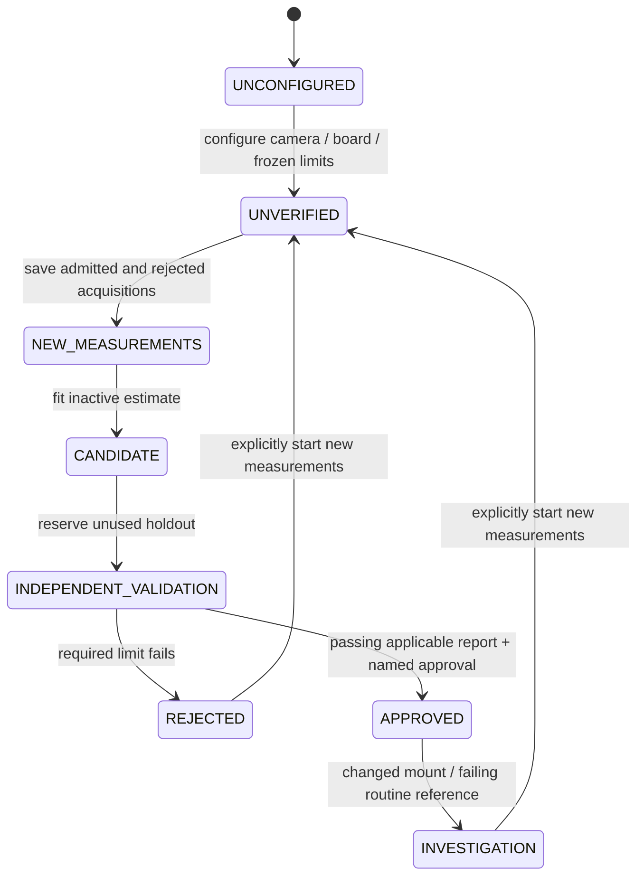
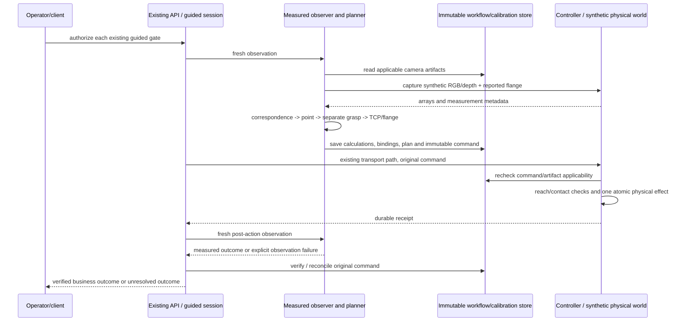

# Measured cell: implemented boundaries

This describes the measured calibration profile, not the legacy copied-pose observer
or proprietary SICS.AI internals. All operational geometry uses Python, meters and
radians. The profile is an ideal Cartesian gantry with an orientable gimbal, not an
HKM1800 kinematic or dynamics model. Numerical defaults are `SIMULATION_ONLY`.

There is no estimator-to-oracle connection. Physical transforms and object poses are
inputs only to sensor generation, physical contact/effects, explicitly labelled scene
presentation and test-oracle comparisons. Fitting sees measured images/corners and
reported flange poses. Runtime perception sees sensor arrays and approved artifacts.
The test oracle is not a runtime fallback.

## Frames and calculations

`T_A_B` maps B into A: `p_A = T_A_B p_B`. Base b is z-up. RGB c and depth d use x
right, y down, z forward. Browser and Blender presentation use base z-up directly;
optical frames are transformed explicitly. Presentation camera orbit is not calibration.

| Quantity | Meaning / implementation |
|---|---|
| A = T_b_f | Reported robot flange pose; input, not a robot-kinematic fit |
| B = T_c_t | Board pose from detected corner IDs and metric board points |
| X = T_b_c | Estimated camera-to-base extrinsic, separately for each camera |
| Y = T_f_t | Board mounting; shared only for an unchanged mounting identity |
| A Y = X B | Calibration constraint; translation and rotation evaluated separately |
| p_d | Z[xn,yn,1] for axial depth, or r[xn,yn,1]/norm for radial range |
| p_c = T_c_d p_d | Native depth-to-RGB registration; projected correspondence is checked |
| p_b = X p_c | Base point; not a complete grasp or execution authorization |
| T_b_f = T_b_tcp inv(T_f_tcp) | Flange-command conversion; TCP-command mode uses the configured TCP once |

`contracts.py` validates rigid transforms, optical models, units, frames, ordered board
points and configuration identities. `estimation.py`, `depth.py`, `registration.py`,
`tcp.py`, `validation.py` and `checks.py` are shared by the service and runnable CLI.
The JavaScript client renders supplied results and geometry only.

Registered RGB-grid depth retains the native measurement meaning and a hashed native
pixel map. The original native array remains available for visibility and neighbourhood
checks. Reindexing does not change an approved camera model. No hole filling, RGB-Z
assumption or undocumented vendor alignment is supported.

## Approval and recovery

Candidate workflow is separate from active-artifact validity (`VERIFIED` or
`SUSPECT_INVALID`). A rejected replacement does not become active. An older artifact
remains auditable but cannot bypass a suspect state. A passing routine check does not
silently restore approval. Controlled reuse copies an eligible saved estimate into a new
inactive candidate with immutable lineage. It requires unused independent validation
and new explicit approval; a moved camera or incompatible mounting cannot reuse old
authority.

Local HTTP is recorded as HTTP. Local broker/edge/OPC substitutes retain their existing
simulated transport labels. In-process Python calls are not presented as HTTP or OPC UA.
The distributed lab retains its own transport adapters and acceptance lane.

## Evidence and presentation

SQLite stores immutable calibration JSON, configuration hashes, request receipts and
revision-checked camera state. PNG/NPY files are content-addressed and hash-verified.
Existing workflow records retain command, journal, post-observation and WMS/ERP evidence.

Python controller reports determine gantry/flange/TCP/product motion, including the
actual contact offset. Browser replay reads those samples. For the measured profile,
Blender renders and re-exports evaluated samples after the controller commit; its
artifacts are labelled `BLENDER_EVALUATED_CONTROLLER_REPLAY`. A render failure cannot
authorize a command, change a receipt, or turn a known controller effect into another pick.

Each new board capture also journals a presentation snapshot in the controller store.
Its flange follows the saved robot report; its camera/board geometry is labelled
synthetic instructor data. The estimator receives only capture/configuration/image
arguments, never this scene. ChArUco display marks use the same dictionary bits and
metric marker locations as the image renderer. GET inspection can show that saved
scene or backend-generated pose/chain/reference/target geometry without a mutation.

Inspection, source viewing, exports, camera viewpoints and replay are read-only.
Pixel inspection is an explicitly labelled recomputation from saved bytes and a selected
artifact, not a new operational observation. Physical sensor placement is not moved to
match an estimated X. Numerical text is available alongside every displayed ray/point.

The export recomputes RGB detection/PnP/fitting, independent validation and rejected
holdout views, native depth, independent tool checks and recorded target calculations.
It includes controller journal commands/receipts and all motion samples with a content
checksum. Replay audits those records; it does not perform a second physical execution.
Application and controller snapshots are each consistent but not one atomic cross-store
snapshot; export a settled run for complete evidence. Old narrower bundles retain their
scope. Source comparison is mandatory for an exact-source reproduction pass.

The current acceptance verdict and evidence are in ACCEPTANCE_REPORT.md and
TRACEABILITY.md. This architecture describes simulation behavior, not real-cell certification.
